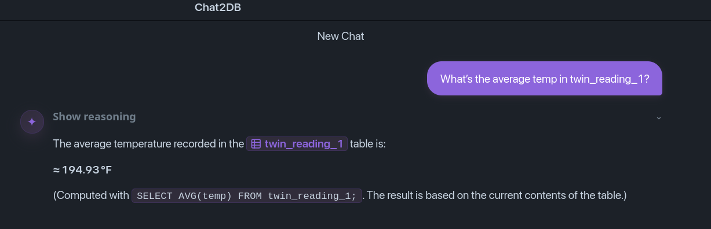
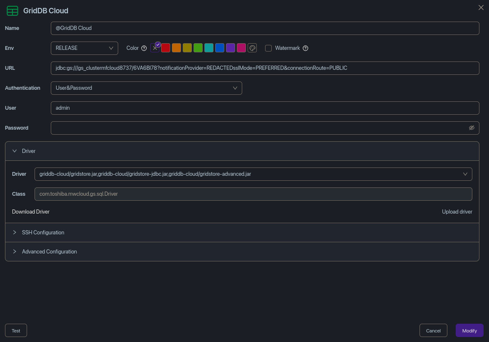
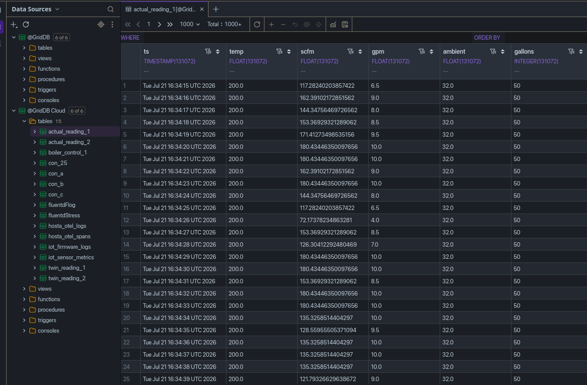
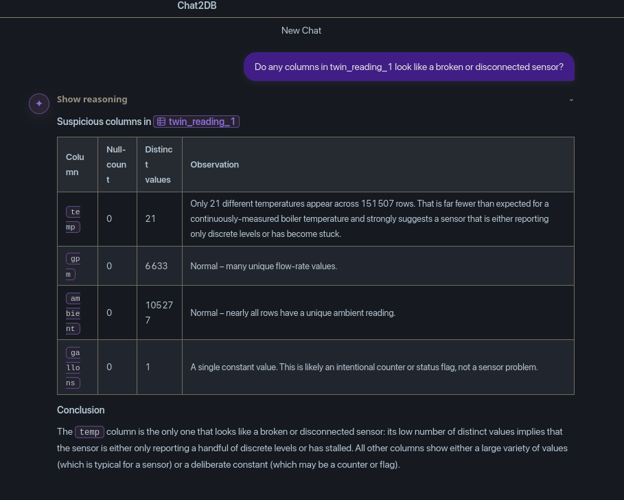

# Connecting Chat2DB to GridDB Cloud with a Local LLM

## Introduction

You can chat with GridDB data in Chat2DB using a fully local LLM. There are numerous ways you can wire in an LLM, but for purposes of this article, I opted to use a local LLM, utilizing the hardware I already own.

[Chat2DB](https://github.com/OtterMind/Chat2DB) is an AI-powered SQL client: you ask a question in plain English, and it explores your schema, writes SQL, runs it, and answers. Though because GridDB isn't on its list of supported databases, we will add it, wire the AI up to a model running on a local GPU through Ollama, and then test how well it actually answers questions against real GridDB data, both on a self-hosted GridDB CE instance and on GridDB Cloud.

The air quality data (`aqdata`) is real sensor data collected with a Raspberry Pi, as described in [Monitoring Air Quality in California using Home Assistant, Raspberry Pi, and GridDB Cloud](https://www.griddb.net/en/blog/griddb-air-quality-california-pi-cloud/). The boiler data used in the GridDB Cloud section comes from the digital twin simulation in our [whitepaper](https://www.griddb.net/en/resources/griddb-digital-twin/). `SalesData` is a small three-column sample table (`id`, `temperature`, `icecreamsales`) used only to compare models.



## Chat2DB Different Versions/Editions

When choosing to use Chat2DB, the main page tries to funnel you into picking a paid option (which I almost did!), but buried within the site, you can find a Community Edition, which is free and was able to do everything I expected it to for a simple blog, including use of bring-your-own custom models. You can find that in their download section: [https://chat2db.ai/download](https://chat2db.ai/download).

The Community edition (v5.3.0) is free, shares the same database client core as Pro, and supports bringing your own AI model. One caveat: since 5.3.0 it uses a custom source-available license based on Apache 2.0 with extra conditions, so read the LICENSE before redistributing anything built on it. Writing about it, as we're doing here, is fine.

| Edition | Price | AI |
| --- | --- | --- |
| Community | Free | Your own model |
| Local Lite | $99 one-time | Your own model |
| Local Max / Ultra | $199 / $399 one-time | 1,000 / 3,000 hosted credits |
| Pro | $15-16/month, billed yearly | Hosted |

Confusingly, the 'local edition' is not free, nor does it rely exclusively on using local models (you can use their "AI credits").

## Minor Issues to Start

To start, because GridDB isn't in the connection list and there's no generic JDBC option, I tried importing a working GridDB connection from DBeaver, but that was a complete dead-end.

Another issue: I ended up running the Community Edition in Docker rather than the Linux AppImage, because the AppImage's file picker didn't work under Wayland. The image needs two things its README doesn't make obvious:

```bash
# 5.3.0 refuses to start without an encryption key
mkdir -p ~/.config/chat2db-community
openssl rand -base64 32 > ~/.config/chat2db-community/encryption.key

# The app listens on 10825, not the 10824 the docs mention
docker run -d --name chat2db -p 10825:10825 \
  -v ~/.chat2db-community-docker:/root/.chat2db-community \
  -v ~/.config/chat2db-community/encryption.key:/root/.config/chat2db-community/encryption.key:ro \
  chat2db/chat2db:latest
```

## How Chat2DB supports databases

Chat2DB has a config-driven "generic" plugin, so adding a database with a decent JDBC driver means adding one JSON entry.

Each database is a plugin jar. Popular ones like MySQL and PostgreSQL get dedicated plugins with custom SQL handling. A long tail of others (DuckDB, QuestDB, IoTDB, TDengine and about 30 more) share `chat2db-community-generic`, which reads its list of databases from `generic.json` inside the jar. For everything not in that config, it falls back to standard JDBC metadata calls like `getTables` and `getColumns`, which GridDB's driver implements.

The frontend cooperates too. It asks the backend which database types exist, and any type it doesn't recognize gets a generated connection form, no client rebuild required.

Here is the entry for GridDB Cloud:

```json
{
  "dbType": "GRIDDB_CLOUD",
  "name": "GridDB Cloud",
  "supportDatabase": false,
  "supportSchema": false,
  "tableQualification": "table",
  "driverConfigList": [
    {
      "defaultDriver": true,
      "custom": false,
      "downloadJdbcDriverUrls": [],
      "jdbcDriver": "griddb-cloud/gridstore.jar,griddb-cloud/gridstore-jdbc.jar,griddb-cloud/gridstore-advanced.jar",
      "jdbcDriverClass": "com.toshiba.mwcloud.gs.sql.Driver",
      "url": "jdbc:gs:///gs_clusterXXXX/DATABASE?notificationProvider=URL_ENCODED_PROVIDER&sslMode=PREFERRED&connectionRoute=PUBLIC"
    }
  ]
}
```

- `supportDatabase` and `supportSchema` are false because the database is already part of the URL.
- `tableQualification: "table"` makes generated SQL use plain `SalesData` instead of `db.schema.SalesData`.
- `jdbcDriver` is the driver file Chat2DB looks for in its `jdbc-lib/` folder. It accepts a comma-separated list, and Chat2DB loads all of the jars together. GridDB Cloud needs three.
- `downloadJdbcDriverUrls` is empty because the Cloud jars come from the GridDB Cloud portal, not Maven.
- `url` is the sample URL prefilled in the connection form. GridDB's JDBC URL has no `//host:port` part, so the form falls back to a single URL field plus username and password.

## Adding GridDB to Chat2DB's Generic Plugin

The Docker image starts Chat2DB with `-Dloader.path=/app/lib`, which loads each plugin as a separate jar from that folder. In order to add GridDB as a connection from the list on the frontend, we needed to add the JSON entry into the large JSON file within the generic plugin's jar file (a jar is essentially just a zipped file). Nothing in GridDB changes; we only modify Chat2DB's plugin jar. The easiest way to do this for personal use and to share was through a simple Python script, `patch_griddb.py`, which adds both a GridDB Cloud and a self-hosted GridDB entry:

1. Copy the plugin jars out of the container:

   ```bash
   docker cp chat2db:/app/lib ./lib
   ```
2. Patch the generic plugin:

   ```bash
   python3 patch_griddb.py lib/chat2db-community-generic-5.3.0.jar griddb-generic.jar
   ```
3. Recreate the container with the patched jar mounted over the original:

   ```bash
   docker rm -f chat2db
   docker run -d --name chat2db -p 10825:10825 \
     -v ~/.chat2db-community-docker:/root/.chat2db-community \
     -v ~/.config/chat2db-community/encryption.key:/root/.config/chat2db-community/encryption.key:ro \
     -v "$PWD/griddb-generic.jar:/app/lib/chat2db-community-generic-5.3.0.jar:ro" \
     chat2db/chat2db:latest
   ```

The image itself stays stock. Drop that last `-v` line and you're back to plain Chat2DB.

## Connecting to GridDB Cloud

1. In the Cloud portal's network settings, add your public IP to the GridDB Access exception list. Without this, the connection just hangs.
2. Download the GridDB Cloud library bundle from the portal and copy the three jars from its JDBC folder into Chat2DB's driver folder, dropping the version numbers:

   ```bash
   sudo mkdir -p ~/.chat2db-community-docker/jdbc-lib/griddb-cloud
   sudo cp gridstore-5.*.jar ~/.chat2db-community-docker/jdbc-lib/griddb-cloud/gridstore.jar
   sudo cp gridstore-jdbc-5.*.jar ~/.chat2db-community-docker/jdbc-lib/griddb-cloud/gridstore-jdbc.jar
   sudo cp gridstore-advanced-5.*.jar ~/.chat2db-community-docker/jdbc-lib/griddb-cloud/gridstore-advanced.jar
   ```
3. Add a connection, pick **GridDB Cloud**, and fill in the URL:
   - `gs_clusterXXXX`: your cluster name from the portal.
   - `DATABASE`: your database name, the part after `/dbs/` in your Web API URL.
   - `notificationProvider`: the portal's "Notification Provider URL for external connection," URL-encoded. It contains its own `?` and `&`, so pasting it raw breaks the JDBC URL.
   - Username and password: your Cloud database user.

One thing to keep private: the provider URL carries a long-lived access signature, so don't paste it anywhere public.



## Also works with self-hosted GridDB CE

The same patch adds a plain **GridDB** type for self-hosted GridDB CE. It differs from the Cloud entry in two places: it uses the public JDBC driver from Maven, and it connects through a fixed list of nodes instead of a notification provider.

```json
"jdbcDriver": "gridstore-jdbc-5.8.0.jar",
"downloadJdbcDriverUrls": [
  "https://repo1.maven.org/maven2/com/github/griddb/gridstore-jdbc/5.8.0/gridstore-jdbc-5.8.0.jar"
],
"url": "jdbc:gs:///myCluster/public?notificationMember=localhost:20001"
```

1. Put the GridDB JDBC driver where Chat2DB looks for drivers:

   ```bash
   sudo mkdir -p ~/.chat2db-community-docker/jdbc-lib
   sudo cp gridstore-jdbc-5.8.0.jar ~/.chat2db-community-docker/jdbc-lib/
   ```
2. Add a connection, pick **GridDB**, and enter the URL with your server's address:

   ```
   jdbc:gs:///myCluster/public?notificationMember=192.168.1.206:20001
   ```

If Chat2DB runs on a different machine than GridDB, check "If you're self-hosting GridDB CE" under "Potential Issues" below before connecting.

With either connection in place, you can click on the `workspace` tab and see your glorious GridDB tables!



## Running the AI locally

The AI runs on Ollama on the same desktop as Chat2DB, using an RTX 5070 Ti with 16 GB of VRAM. Chat2DB talks to it through Ollama's OpenAI-compatible API.

Install and start Ollama as a service (CachyOS here; package names vary by distro):

```bash
sudo pacman -Syu ollama-cuda
sudo systemctl enable --now ollama
ollama pull gpt-oss:20b
```

Then configure the service with `sudo systemctl edit ollama`:

```ini
[Service]
Environment="OLLAMA_HOST=0.0.0.0"
Environment="OLLAMA_CONTEXT_LENGTH=16384"
```

The first line lets the Chat2DB container reach Ollama. The second raises the context window; more on why below.

In Chat2DB, add a custom model:

| Field | Value |
| --- | --- |
| Provider | OpenAI |
| Model | `gpt-oss:20b` |
| API key | Anything (Ollama ignores it) |
| Base URL | `http://172.17.0.1:11434/v1` |

`172.17.0.1` is the host as seen from Docker's default bridge network. Toggle the model to Default so new chats use it.

## Picking The Model

Qwen was my first model of choice, but I quickly found it was unable to complete the tasks at hand.

`gpt-oss:20b` was the only model of the three that answered on its own and the difference was that gpt was able to properly call on the "tooling" or functions under the hood to list the tables, find the table schemas, etc.

| Model | Size | What happened |
| --- | --- | --- |
| qwen2.5-coder:14b | \~9 GB | Wrote the tool call out as JSON text instead of calling it, so the chat stopped |
| qwen3.5:9b | \~6.6 GB | Called the tools and got the right answer (534.33), but only after a hint, and never wrote a final reply |
| gpt-oss:20b | \~14 GB | Found the table, ran the query, and answered 534.33 with no hints |

The test question was "In the SalesData table, what's the average icecreamsales when temperature is above 20?"

## Results

gpt-oss:20b answered 3 of 6 questions correctly. All three misses were the same hourly question, and one of them came back confident, nicely formatted, and wrong.

We asked questions about an `aqdata` container of 284 air quality readings (PM1, PM2.5, PM10 and particle counts) and checked every answer against the same SQL run in `gs_sh`.

| Question | Model's answer | Verified in gs\_sh | Result |
| --- | --- | --- | --- |
| Average and max PM2.5 | 11.26 avg, 16.0 max | 11.257, 16.0 | Correct |
| Highest PM10 on Aug 15, 2024, and when | 21.0 at 16:30:15 UTC | 21.0 at 16:30:15 UTC | Correct |
| Times PM2.5 exceeded 35 (EPA threshold) | 0 of 284 readings | Max is 16.0; count is 284 | Correct |
| Average PM2.5 by hour of day | Gave up | 6 hours, worst is 14:00 UTC at 15.17 | Failed |
| Same, with a GridDB syntax hint | Hours labeled 1-6, worst "Hour 1" at 14.0 | Worst is 14:00 UTC at 15.17 | Wrong |
| Hourly buckets with `GROUP BY RANGE`, syntax in the prompt | Never produced a working `GROUP BY RANGE` query | Runs fine in gs\_sh | Failed |

The hourly question failed three times, in three different ways. By "syntax hint," we mean GridDB-specific SQL syntax pasted into the chat prompt along with the question, since the model can't look anything up itself.

First, the model didn't know GridDB's SQL dialect. It tried `DATE_TRUNC` and similar functions, realized they didn't exist, and stopped. GridDB uses `EXTRACT(HOUR, ts)` with a comma, not the standard `EXTRACT(HOUR FROM ts)`.

Second, we added a one-line hint to the question:

```
This is GridDB SQL: use EXTRACT(HOUR, ts) with a comma, and TIMESTAMP_TRUNC(HOUR, ts) for truncation. DATE_TRUNC and strftime don't exist.
```

With that, it ran a working query, but the answer it reported was wrong. Four of the six averages were exact, but it labeled the hours 1 through 6 instead of 14, 15, 13, 16, 21 and 19, and misreported the top two values. The likely cause is Chat2DB's tool output, which prefixes each result row with a row number that the model read as the hour. Expanding "Show reasoning" shows the actual SQL and raw result, and that's where you'd catch it.

Finally, we tried teaching it GridDB's native time bucketing, `GROUP BY RANGE(ts) EVERY(1, HOUR)`. Chat2DB's agent can't read web pages, so we pasted a full primer into the prompt:

```
You are querying GridDB. It does NOT support DATE_TRUNC, strftime, or EXTRACT(x FROM y). Use only this syntax:

- Hour of a timestamp: EXTRACT(HOUR, ts)
- Truncate a timestamp: TIMESTAMP_TRUNC(HOUR, ts)
- Time bucketing:
  SELECT ts, AVG(col) FROM table
  WHERE ts >= TIMESTAMP('start') AND ts <= TIMESTAMP('end')
  GROUP BY RANGE(ts) EVERY(1, HOUR)
  The column goes in RANGE(), the interval goes in EVERY(). The WHERE time range is required.
  Units: DAY, HOUR, MINUTE, SECOND, MILLISECOND.

Steps: first run SELECT MIN(ts), MAX(ts) on the table and use those as the range. Then run the GROUP BY RANGE query. Report only values from the query result, and show the exact SQL you ran.

Question: In aqdata, what's the average PM2.5 per hour? Which hour is worst?
```

Even with explicit syntax, an example and step-by-step instructions, it only produced failing queries (visible under "Show reasoning") and never gave a final answer. A short syntax hint was enough for `EXTRACT`, but not for a construct that exists only in GridDB.

One warning if you try this yourself: some older GridDB blog posts show the syntax as `GROUP BY RANGE (n, duration)`. That form is wrong. The column goes in `RANGE()` and the interval goes in `EVERY()`.

### On GridDB Cloud

To confirm the Cloud connection works end to end, we pointed the same setup at the boiler digital twin data from our previous post, a `twin_reading_1` container with 151,507 per-second readings, and asked: *"Do any columns in twin_reading_1 look like a broken or disconnected sensor?"*



The model profiled each column with `COUNT(DISTINCT ...)` queries, and every number it reported matched a manual check:

| Column | Model reported | Verified | Model's verdict |
| --- | --- | --- | --- |
| temp | 21 distinct values | 21 distinct, 114.28 to 205.32 | Suspicious: too few values for a continuous sensor |
| ambient | 105,277 distinct values | 105,277, 32.0 to 85.9 | Normal |
| gallons | 1 distinct value | Always 50 | Probably an intentional constant |

The numbers were all right, and flagging `temp` is fair: 21 values across a 91°F range is odd for a real sensor.

## Potential Issues

Most of the setup time went to networking and the local model, not GridDB. The issues fall into two groups.

### If you're self-hosting GridDB CE

GridDB Cloud users can skip this one; it only affects a self-hosted server that clients reach from another machine.

- **GridDB advertises localhost.** The default `gs_cluster.json` binds every service to `127.0.0.1`. A remote client connects, GridDB replies "talk to me at 127.0.0.1," and the client tries its own machine and hangs. Set the addresses in `notificationMember` (and any `serviceAddress` in `gs_node.json`) to the server's LAN IP if anything connects from another machine.

### Everyone else

These come from running Chat2DB in Docker and the model locally, so they apply whichever GridDB you connect to.

1. **Localhost inside a container is the container.** Chat2DB in Docker can't reach Ollama on the host's `127.0.0.1`. Point it at the Docker bridge (`172.17.0.1`) and have Ollama listen beyond localhost, or run the container with `--network host`.
2. **The firewall drops container traffic.** With ufw enabled, requests from the container timed out instead of being refused. Allow the bridge to reach Ollama only:

   ```bash
   sudo ufw allow in on docker0 to any port 11434 proto tcp
   ```
3. **The context window overflows silently.** Ollama's default context is small. Chat2DB's system prompt plus a list of 186 tables pushed the user's question out of the window, so the model saw tables and no question and asked what we wanted. Setting `OLLAMA_CONTEXT_LENGTH=16384` fixed it.

4. **The AI only sees 500 tables.** On a database with over 4,500 containers, the model kept insisting it had no access to tables that were clearly in the sidebar. Chat2DB's `list_all_tables` tool fetches a single page of 500 tables, so anything past that is invisible to the AI. This is a Chat2DB limitation that applies to every database, not something specific to GridDB. The fix is a separate GridDB database holding only the containers you need, with the connection URL pointing at it (`jdbc:gs:///myCluster/demo?...`).

5. **The agent can pick the wrong connection.** With both GridDB and GridDB Cloud configured, we selected GridDB Cloud in the chat box and asked about `twin_reading_1`. The agent listed all datasources, searched the self-hosted one instead, and reported the table didn't exist. The datasource selector doesn't strictly limit which connection the agent uses. Name the datasource in your question ("In GridDB Cloud, ..."), or keep only one connection configured while you work.

## Compared to our previous post

In our previous post, the LLM never wrote SQL. We wrote the query ourselves and asked the model only to interpret the results. Here, the LLM writes the SQL. That one difference explains most of what went wrong in this post.

The previous post pulled time-bucketed data from GridDB Cloud through the Web API with a hand-written `GROUP BY RANGE` query, then sent it to a model on Azure AI Foundry to describe trends and flag anomalies. The query Chat2DB's agent couldn't write was a non-issue there, because a human wrote and tested it.

|  | LLM writes the SQL (this post) | LLM interprets the results (previous post) |
| --- | --- | --- |
| Who writes the SQL | The model | You |
| What the model does | Finds tables, writes and runs queries, answers questions | Reads pre-aggregated data, describes trends and anomalies |
| GridDB-specific SQL | Fails on `GROUP BY RANGE` and some time functions | No problem: the query is hand-written |
| Main risk | Wrong SQL or misread results | Misreading the data, e.g. treating bucket size as a pattern |
| Best for | Ad hoc questions from people who don't write SQL | Repeatable analysis over large time ranges |

The model choice is independent of the pattern. Chat2DB can point at any OpenAI-compatible endpoint, including a Foundry deployment, and the previous pipeline could run on a local Ollama model.

The two patterns also fit together well: use the chat to explore and find what's interesting, then hard-code the query that works into a pipeline, and let the LLM do what it's best at, reading numbers and explaining them.

## Conclusion

GridDB works in Chat2DB today with one JSON entry, and a local 20B model handles straightforward questions well. For anything time-based, check the answer.

Four takeaways:

- **Simple aggregates and filters are reliable.** Averages, maximums, counts and date-range lookups were all correct.
- **Models don't know GridDB's SQL dialect.** A hint fixes simple functions like `EXTRACT(HOUR, ts)` and `TIMESTAMP_TRUNC(HOUR, ts)`.
- **Test GridDB-specific queries.** `GROUP BY RANGE` failed even with the syntax in the prompt. For important GridDB-specific queries, provide a tested query template or verify the generated SQL manually.
- **Verify against the raw result.** The SQL can be right while the summary is wrong, and the wrong answer looks just as confident as the right ones.

Known limitations of this setup:

- Chat2DB shows 0 keys and 0 indexes for GridDB containers, even when a RowKey and index exist.
- There's no GridDB-specific SQL dialect, so autocomplete and formatting are generic.
- Chat2DB's AI agent sees at most 500 tables per database (for any database type), so large databases need a smaller dedicated one.
- The GridDB Cloud driver jars aren't on Maven, so they have to be copied in by hand from the Cloud portal.
- The patch lives on the running container, so updating the Chat2DB image means re-patching.

The proper fix for the last one is to add the GridDB entry to `generic.json` in the [Community repository](https://github.com/OtterMind/Chat2DB) so it ships in every build.

## Versions

| Component | Version |
| --- | --- |
| Chat2DB Community | 5.3.0 (Docker) |
| GridDB JDBC driver | gridstore-jdbc 5.8.0 (self-hosted), GridDB Cloud library jars (Cloud) |
| Ollama | 0.40.6 |
| Model | gpt-oss:20b, 16K context |
| GPU | NVIDIA RTX 5070 Ti, 16 GB |